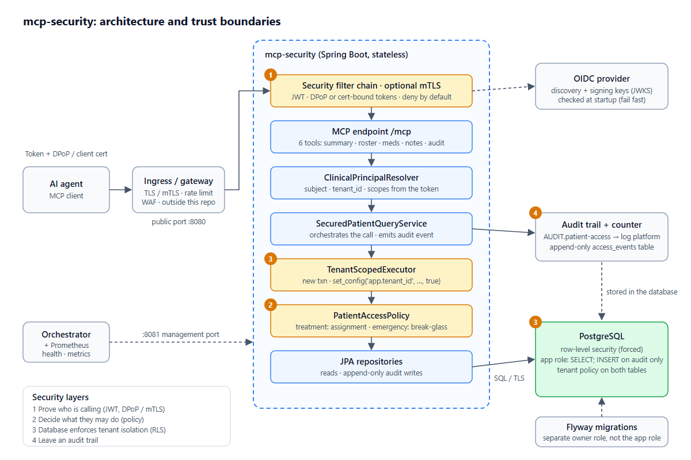
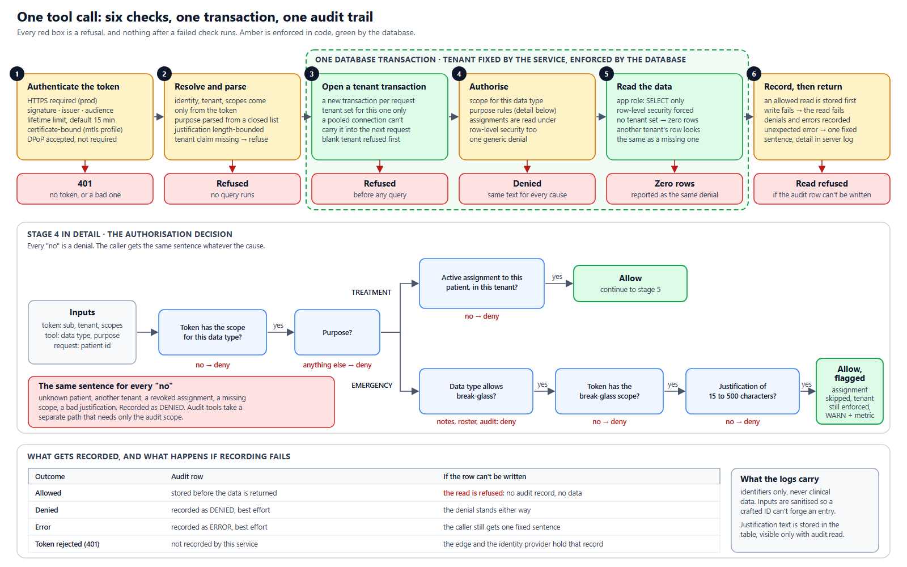

# Application Security for AI Tools & MCP: An Incremental Reference Implementation & Curriculum

[](https://openjdk.org/projects/jdk/27/)
[](https://spring.io/projects/spring-boot)
[](https://modelcontextprotocol.io)
[](https://www.postgresql.org/docs/current/ddl-rowsecurity.html)

A Spring Boot [Model Context Protocol](https://modelcontextprotocol.io) (MCP) server that lets an AI agent read patient records, engineered to demonstrate the **defense-in-depth security controls** required before an autonomous AI tool is permitted near sensitive enterprise data (such as Protected Health Information / PHI under HIPAA).

> **Educational Reference Implementation:** This repository is structured as both a working, production-grade reference implementation and an **incremental multi-page educational curriculum** to teach Application Security for AI Tools, AI Agents, and Tool Calling. All patient data is synthetic.

---

## 🎓 The Multi-Page Learning Curriculum

This repository includes a step-by-step, incremental course designed to teach security engineers, AI developers, and cloud architects how to secure Model Context Protocol (MCP) servers and AI agent tool integrations:

👉 **[Start the Curriculum: Master Index & Syllabus](curriculum/README.md)**

```
┌────────────────────────────────────────────────────────────────────────┐
│ THE INCREMENTAL LEARNING CURRICULUM                                    │
├────────────────────────────────────────────────────────────────────────┤
│ 📖 Module 01: Threat Modeling & MCP Trust Boundaries                   │
│    - The AI agent dilemma, OWASP Top 10 for LLMs, and trust boundaries │
│    🔗 [Read Module 01](curriculum/01-threat-modeling-and-trust-boundaries.md)            │
├────────────────────────────────────────────────────────────────────────┤
│ 📖 Module 02: Transport Layer Security & Ingress Hardening             │
│    - Fail-hard HTTPS, port segregation (8080 vs 8081), and zero-cache  │
│    🔗 [Read Module 02](curriculum/02-transport-and-edge-security.md)                     │
├────────────────────────────────────────────────────────────────────────┤
│ 📖 Module 03: Token Binding & Cryptographic Authentication             │
│    - User delegation, audience locking, and RFC 8705 mTLS token binding │
│    🔗 [Read Module 03](curriculum/03-authentication-and-token-binding.md)              │
├────────────────────────────────────────────────────────────────────────┤
│ 📖 Module 04: Contextual Authorization, Scopes & Break-Glass           │
│    - Fine-grained scopes, ReBAC assignments, and emergency overrides   │
│    🔗 [Read Module 04](curriculum/04-contextual-authorization-and-breakglass.md)        │
├────────────────────────────────────────────────────────────────────────┤
│ 📖 Module 05: Data-Tier Multi-Tenancy & PostgreSQL Row-Level Security   │
│    - Kernel RLS, transaction-scoped tenants, and least-privilege roles  │
│    🔗 [Read Module 05](curriculum/05-data-tier-isolation-and-row-level-security.md)    │
├────────────────────────────────────────────────────────────────────────┤
│ 📖 Module 06: Non-Repudiation, Fail-Closed Auditing & Immutable Logs   │
│    - "No audit, no data" paradigm, append-only DB tables, duty checks  │
│    🔗 [Read Module 06](curriculum/06-fail-closed-auditing-and-non-repudiation.md)      │
├────────────────────────────────────────────────────────────────────────┤
│ 📖 Module 07: Privacy by Design, Data Minimization & Side Channels     │
│    - Domain toString() redaction, CWE-117 log forging, error masking   │
│    🔗 [Read Module 07](curriculum/07-privacy-data-minimization-and-side-channels.md)    │
├────────────────────────────────────────────────────────────────────────┤
│ 📖 Module 08: Automated Security Testing & Verification Harness        │
│    - Testcontainers harness, testing DB RLS, and log leak assertions   │
│    🔗 [Read Module 08](curriculum/08-automated-security-verification.md)               │
├────────────────────────────────────────────────────────────────────────┤
│ 📖 Module 09: Production Hardening, Monitoring & Threat Playbook       │
│    - Zero-secret config, Prometheus anomaly alerts, incident triage    │
│    🔗 [Read Module 09](curriculum/09-production-hardening-and-threat-playbook.md)      │
└────────────────────────────────────────────────────────────────────────┘
```

---

## 🛡️ Core Safety Assumptions

Returning PHI to an AI agent is **not safe by default**. Tool responses are transmitted to third-party LLM providers and recorded in host transcripts. Treat the following as non-negotiable preconditions before connecting this service to real patient data:

| # | Assumption | Owner | Enforced here? |
|---|---|---|---|
| 1 | The model provider operates under a **business associate agreement (BAA)** with confirmed zero data retention. | Organisation | No (External legal policy) |
| 2 | The **agent host** is itself a covered system with encrypted local transcripts and traces. | Organisation | No (Client-side workstation governance) |
| 3 | The agent acts **only with the end user's own short-lived token**, never a shared service credential. | Agent host & IdP | **Yes:** Validates subject, tenant, audience, and rejects tokens older than 15 minutes (`JWT_MAX_LIFETIME`). |
| 4 | **Only approved agent hosts** can connect. | Platform | **Yes:** When the `mtls` profile is on, requires client certificates. |
| 5 | The identity provider enforces **multi-factor authentication** and mints valid `tenant_id` claims. | IdP Owner | Assumed: Service trusts signed JWTs from `OIDC_ISSUER`. |
| 6 | The ingress terminates TLS, rate-limits, and isolates the management port. | Platform | **Yes:** `RequireHttpsFilter` rejects plain HTTP; port 8081 is separated from public 8080. |
| 7 | The database enforces **encryption at rest** and runs with a restricted runtime role. | Platform | **Yes:** Migrations provision least-privilege `healthcare_app` runtime user distinct from migration owner. |
| 8 | **Application logs are strictly restricted** from holding clinical data or free-text justifications. | Development | **Yes:** Verified by `PhiLogLeakIT` and record `toString()` redactions. |
| 9 | **Real-time alerting exists** for break-glass use and denial spikes. | Operations | **Yes:** Emits Prometheus metric counters (`clinical_patient_access_total`). |
| 10 | A formal **risk analysis**, workforce training, and breach procedure are established. | Organisation | Administrative policy. |

---

## 🏛️ Architecture & Verification Gates

Every tool call processed by this server must pass **six distinct verification gates** across a single database transaction:





*(Editable SVG sources are available in `docs/architecture.svg` and `docs/security-flow.svg`)*

---

## 🔒 Security Mechanisms & Test Proofs

| Mechanism | Threat Addressed | Implementation | Verification Test |
|---|---|---|---|
| **Audience Validation** | Token minted for another microservice is replayed | [`JwtSecurityConfig.java`](src/main/java/io/github/rahulrajsonu/mcpsecurity/filter/JwtSecurityConfig.java) | [`JwtSecurityConfigTest.java`](src/test/java/io/github/rahulrajsonu/mcpsecurity/filter/JwtSecurityConfigTest.java) |
| **Short-Lived Tokens** | Stolen token remains usable indefinitely | [`JwtSecurityConfig.java`](src/main/java/io/github/rahulrajsonu/mcpsecurity/filter/JwtSecurityConfig.java) | [`TokenLifetimeValidatorTest.java`](src/test/java/io/github/rahulrajsonu/mcpsecurity/filter/TokenLifetimeValidatorTest.java) |
| **Mutual TLS & Certificate-Bound Tokens (RFC 8705)** | Stolen token replayed from another machine or proxy | [`CertificateBoundTokenFilter.java`](src/main/java/io/github/rahulrajsonu/mcpsecurity/security/CertificateBoundTokenFilter.java) | [`MutualTlsIT.java`](src/test/java/io/github/rahulrajsonu/mcpsecurity/MutualTlsIT.java) |
| **Deny-by-Default Ingress & Port Separation** | Accidental exposure of operational endpoints (SSRF/RCE) | [`SecurityConfig.java`](src/main/java/io/github/rahulrajsonu/mcpsecurity/config/SecurityConfig.java) | [`SecurityEndpointsIT.java`](src/test/java/io/github/rahulrajsonu/mcpsecurity/SecurityEndpointsIT.java) |
| **Fail-Hard HTTPS Enforcement** | Cleartext sniffing of bearer tokens and patient queries | [`RequireHttpsFilter.java`](src/main/java/io/github/rahulrajsonu/mcpsecurity/security/RequireHttpsFilter.java) | [`HttpsEnforcementIT.java`](src/test/java/io/github/rahulrajsonu/mcpsecurity/HttpsEnforcementIT.java) |
| **Contextual Authorization & ReBAC** | Over-broad access; accessing unassigned patients | [`PatientAccessPolicy.java`](src/main/java/io/github/rahulrajsonu/mcpsecurity/security/PatientAccessPolicy.java) | [`PatientAccessPolicyTest.java`](src/test/java/io/github/rahulrajsonu/mcpsecurity/security/PatientAccessPolicyTest.java) |
| **Break-Glass Emergency Governance** | Insider abuse; unrecorded emergency access | [`PatientAccessPolicy.java`](src/main/java/io/github/rahulrajsonu/mcpsecurity/security/PatientAccessPolicy.java), [`AccessAuditLogger.java`](src/main/java/io/github/rahulrajsonu/mcpsecurity/security/AccessAuditLogger.java) | [`ClinicalToolsEndToEndIT.java`](src/test/java/io/github/rahulrajsonu/mcpsecurity/ClinicalToolsEndToEndIT.java) |
| **Indistinguishable Refusals** | Patient enumeration across tenants | [`SecuredPatientQueryService.java`](src/main/java/io/github/rahulrajsonu/mcpsecurity/service/SecuredPatientQueryService.java) | [`PatientAccessEndToEndIT.java`](src/test/java/io/github/rahulrajsonu/mcpsecurity/PatientAccessEndToEndIT.java) |
| **PostgreSQL Row-Level Security (RLS)** | Cross-tenant data leaks; forgotten SQL `WHERE` clauses | [`TenantScopedExecutor.java`](src/main/java/io/github/rahulrajsonu/mcpsecurity/security/TenantScopedExecutor.java), [`V4`](src/main/resources/db/migration/V4__enable_tenant_rls.sql), [`V6`](src/main/resources/db/migration/V6__secure_clinical_data.sql) | [`TenantScopedExecutorIT.java`](src/test/java/io/github/rahulrajsonu/mcpsecurity/security/TenantScopedExecutorIT.java) |
| **Least-Privilege Database Role** | SQL injection deleting data or modifying history | [`V3`](src/main/resources/db/migration/V3__create_database_role.sql), [`V6`](src/main/resources/db/migration/V6__secure_clinical_data.sql) | [`AppendOnlyAuditIT.java`](src/test/java/io/github/rahulrajsonu/mcpsecurity/AppendOnlyAuditIT.java) |
| **Fail-Closed Append-Only Audit Trail** | "No audit, no data"; repudiation; audit tampering | [`AccessAuditor.java`](src/main/java/io/github/rahulrajsonu/mcpsecurity/service/AccessAuditor.java), [`SecuredPatientQueryService.java`](src/main/java/io/github/rahulrajsonu/mcpsecurity/service/SecuredPatientQueryService.java) | [`AuditFailClosedIT.java`](src/test/java/io/github/rahulrajsonu/mcpsecurity/AuditFailClosedIT.java), [`AppendOnlyAuditIT.java`](src/test/java/io/github/rahulrajsonu/mcpsecurity/AppendOnlyAuditIT.java) |
| **Audit Duty Segregation** | Clinicians reviewing or tampering with audit logs | [`PatientAccessPolicy.java`](src/main/java/io/github/rahulrajsonu/mcpsecurity/security/PatientAccessPolicy.java) | [`ClinicalToolsEndToEndIT.java`](src/test/java/io/github/rahulrajsonu/mcpsecurity/ClinicalToolsEndToEndIT.java) |
| **Side-Channel Log & Error Redaction** | PHI leaking into logging infrastructure or AI prompts | [`domain records`](src/main/java/io/github/rahulrajsonu/mcpsecurity/mcp/domain/), [`AccessAuditLogger.java`](src/main/java/io/github/rahulrajsonu/mcpsecurity/security/AccessAuditLogger.java) | [`PhiLogLeakIT.java`](src/test/java/io/github/rahulrajsonu/mcpsecurity/PhiLogLeakIT.java), [`PhiRedactionTest.java`](src/test/java/io/github/rahulrajsonu/mcpsecurity/mcp/domain/PhiRedactionTest.java) |

---

## 🧰 The Model Context Protocol (MCP) Tools

Tools are exposed via Streamable HTTP under `/mcp` using Spring AI MCP Server:

| Tool Name | Scopes Required | Capabilities & Policy Constraints |
|---|---|---|
| `getPatientSummary(patientId, purpose?, justification?)` | `patient.read` | Requires active clinician assignment. Allows break-glass emergency read. Excludes MRN (data minimization). |
| `listMyPatients()` | `patient.read` | Returns active roster entries for caller. Expired or revoked assignments disappear. No emergency form. |
| `getPatientMedications(patientId, purpose?, justification?)` | `patient.read`, `medication.read` | Category-specific scope. Allows break-glass emergency read. |
| `getClinicalNotes(patientId, purpose?, justification?)` | `patient.read`, `notes.read` | Category-specific scope. **Break-glass is strictly refused** even if held by caller. |
| `getAccessHistory(patientId, limit?)` | `audit.read` | Compliance officer tool. Isolated by tenant. Reading the audit log is itself audited. |
| `listBreakGlassEvents(limit?)` | `audit.read` | Compliance officer tool. Lists emergency reads with stated clinical justifications. |

---

## 🚀 Quickstart & Local Execution

### Prerequisites
- JDK 27
- PostgreSQL 17 or 18 (with `psql` client)
- Node.js 18+ (for OAuth device flow helper)

### 1. One-Time Database Setup
```bash
psql -U postgres -c "CREATE DATABASE patient_db"
psql -U postgres -c "CREATE ROLE healthcare_app LOGIN PASSWORD 'postgres'"
```

### 2. Boot Application (Local Profile)
```bash
SPRING_PROFILES_ACTIVE=local \
OIDC_ISSUER=https://your-idp/realms/your-realm \
./mvnw spring-boot:run
```
The server listens on **8080** (public MCP listener) and **8081** (internal actuator metrics).

### 3. Hands-On Verification with Claude Desktop
Follow the hands-on tutorial to connect Claude Desktop to a real Keycloak instance on Cloud-IAM and test live tool interactions:  
👉 **[Read the Hands-On Cloud-IAM & Claude Desktop Guide](docs/cloud-iam-guide.md)**

---

## 🧪 Automated Testing & Verification

Integration tests leverage Testcontainers to spin up isolated PostgreSQL instances and assert database-level security policies:

```bash
# Run all unit tests
./mvnw test -Dtest=*Test

# Run all unit and integration tests (requires Docker)
./mvnw verify
```

To run integration tests against a pre-existing local database without Docker:
```bash
IT_DB_URL=jdbc:postgresql://localhost:5432/scratch_db \
IT_DB_OWNER=postgres \
IT_DB_OWNER_PASSWORD=secret \
IT_DB_APP_PASSWORD=secret \
./mvnw verify
```

---

## 📖 Additional Documentation & Resources

- [Multi-Page Learning Curriculum](curriculum/README.md)
- [PHI & PII Handling Guide](docs/phi-handling.md)
- [Cloud-IAM & Claude Desktop Integration Guide](docs/cloud-iam-guide.md)
- [Architecture Diagram Source](docs/architecture.svg)
- [Security Flow Diagram Source](docs/security-flow.svg)
