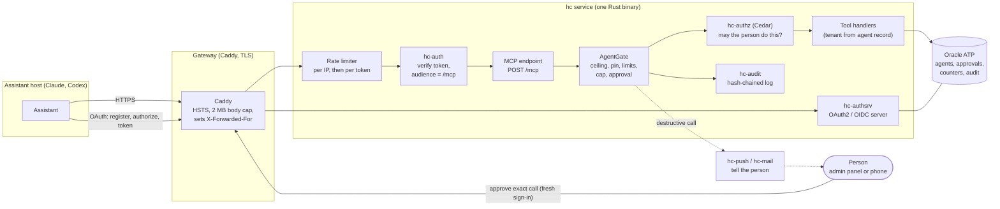
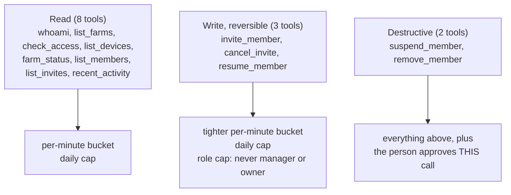
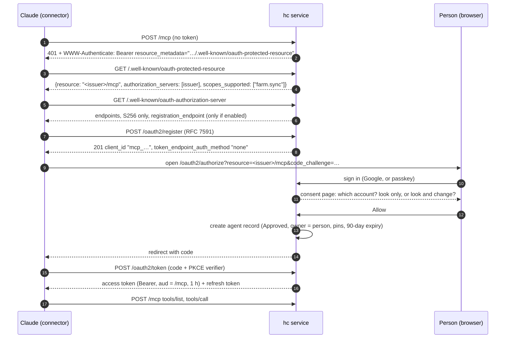
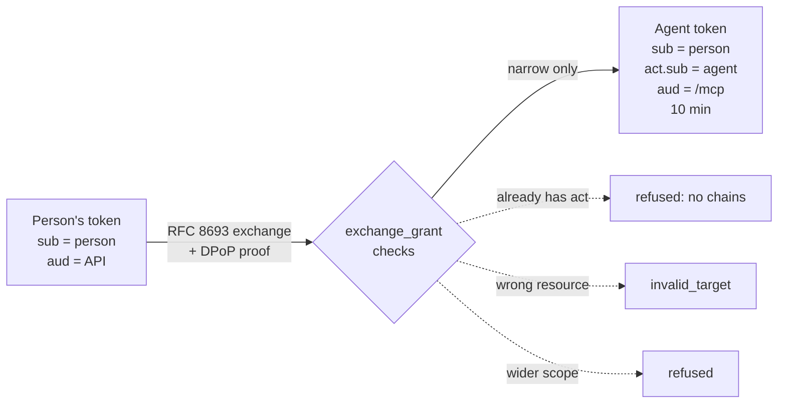
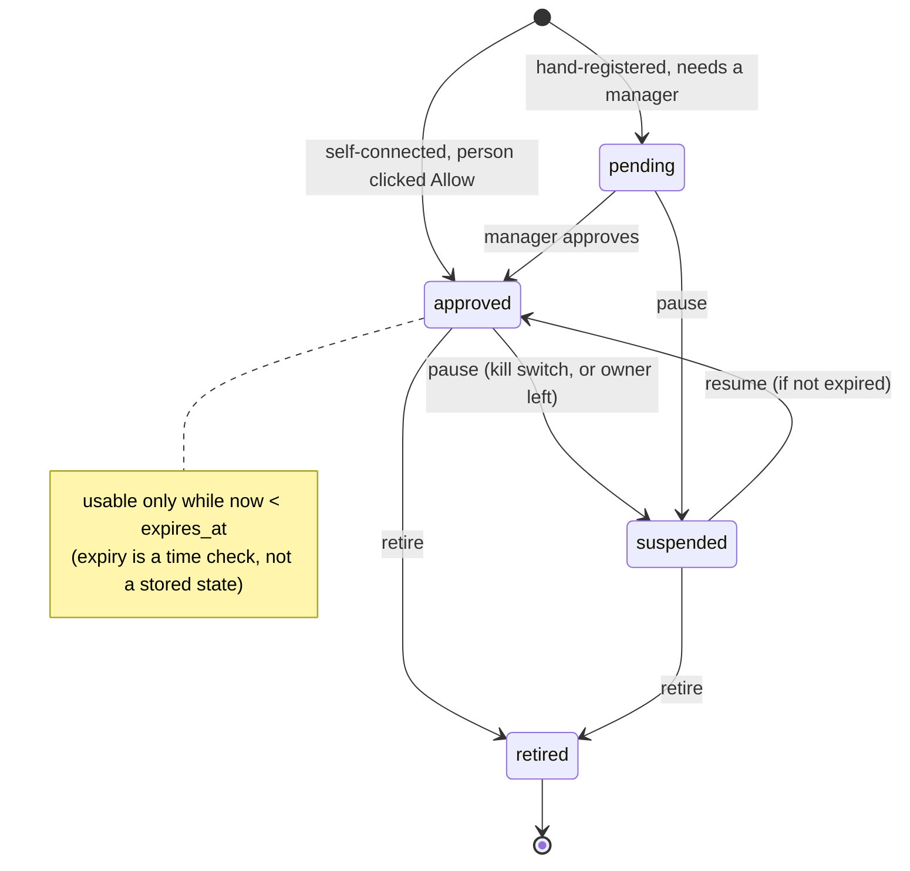
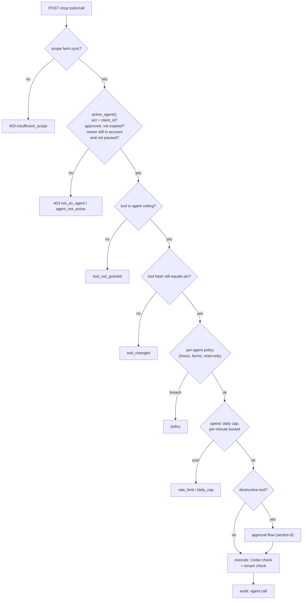
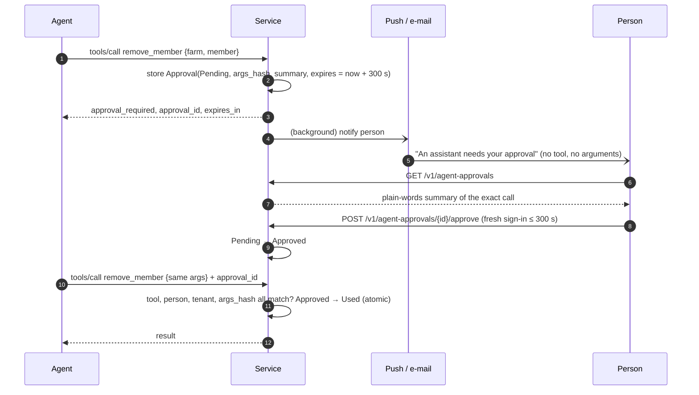
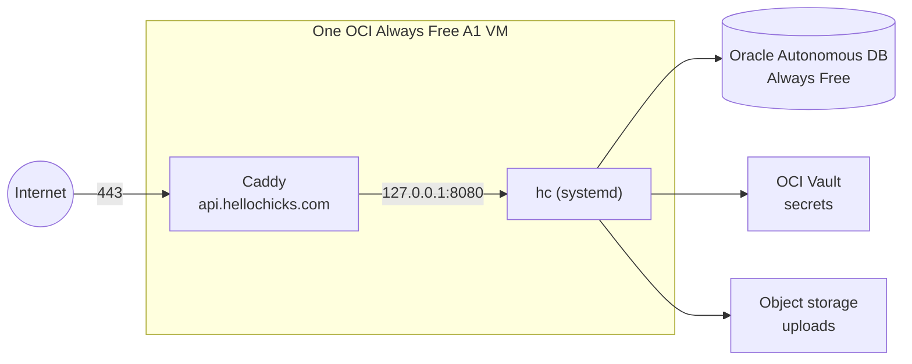
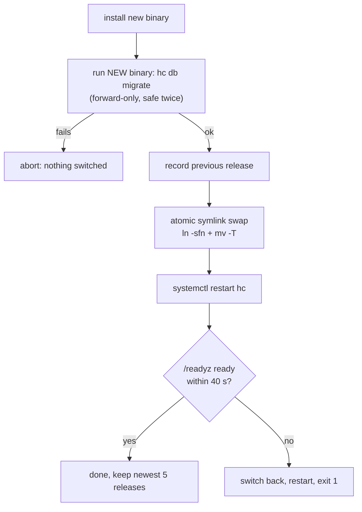
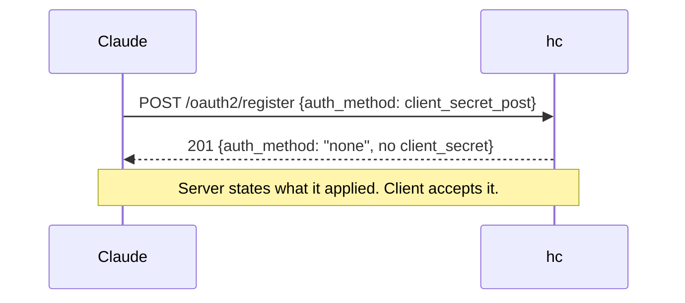

# Running an MCP server in production, and securing it

A field guide built from a real system: the Hello Chicks service, a Rust (axum) API with an OAuth2 server, Oracle storage and a Cedar policy engine, which exposes a Model Context Protocol (MCP) endpoint so that AI assistants such as Claude can look at a farmer's data on the farmer's behalf.

This is not a spec summary. It is the design, the code, the bugs we hit, and the fixes. Where something is not built or not tested, it says so (see [section 11](#11-what-is-not-done-or-not-verified)).

**Who this is for:** engineers who have built a small MCP server and now have to put one in front of real people and real data.

**Where the code is.** Paths are relative to `hello-chicks-service/` in this repository.

| Concern | Location |
| --- | --- |
| MCP endpoint, tools, approval gate | `crates/hc-api/src/mcp.rs` |
| Agent registry, per-agent limits, audit | `crates/hc-api/src/agents.rs`, `crates/hc-authsrv/src/agents.rs` |
| Self-registration of assistants (RFC 7591) and consent | `crates/hc-authsrv/src/mcp_host.rs`, `consent.rs` |
| Token endpoint, token exchange, DPoP | `crates/hc-authsrv/src/token.rs`, `dpop.rs` |
| Discovery documents | `crates/hc-authsrv/src/metadata.rs` |
| Bearer check, audience split, `WWW-Authenticate` | `crates/hc-auth/src/lib.rs` |
| Authorization (Cedar) | `crates/hc-authz`, policy in `policies/farm.cedar` |
| Audit chain | `crates/hc-audit` |
| Rate limiter | `crates/hc-bin/src/ratelimit.rs` |
| Deploy, gateway, backup | `deploy/deploy.sh`, `deploy/Caddyfile`, `deploy/backup-db.sh` |

---

## Contents

1. [The problem: an assistant is not a user](#1-the-problem-an-assistant-is-not-a-user)
2. [Architecture at a glance](#2-architecture-at-a-glance)
3. [The transport: stateless Streamable HTTP](#3-the-transport-stateless-streamable-http)
4. [Tools: tiers, schemas and pinning](#4-tools-tiers-schemas-and-pinning)
5. [Connecting an assistant: discovery, registration, consent](#5-connecting-an-assistant-discovery-registration-consent)
6. [Tokens: audience, lifetime, binding, revocation](#6-tokens-audience-lifetime-binding-revocation)
7. [Deciding every call: the gate](#7-deciding-every-call-the-gate)
8. [Destructive tools: the human approves the exact call](#8-destructive-tools-the-human-approves-the-exact-call)
9. [Production operations](#9-production-operations)
10. [Problems we hit and how we fixed them](#10-problems-we-hit-and-how-we-fixed-them)
11. [What is not done or not verified](#11-what-is-not-done-or-not-verified)
12. [A checklist you can copy](#12-a-checklist-you-can-copy)
13. [Glossary](#13-glossary)

---

## 1. The problem: an assistant is not a user

A normal API client is a program you wrote, holding a key you issued. An MCP client is different in four ways, and each one drives a design decision below.

| Difference | Why it matters | What we did |
| --- | --- | --- |
| **The caller is chosen by the user, not by you.** Anyone can paste your URL into Claude. | You cannot pre-register clients by hand. | Dynamic client registration, with strict limits ([5](#5-connecting-an-assistant-discovery-registration-consent)). |
| **The caller acts for a person**, with that person's data. | A token must never carry more power than the person, and must say who the actor is. | Delegation: `sub` is the person, `act` is the agent ([6](#6-tokens-audience-lifetime-binding-revocation)). |
| **The caller is steered by text it reads**, including text inside your own tool results. | Prompt injection and tool poisoning are real. A tool description can change after approval. | Tools are pinned by hash, results are plain data, and destructive actions need a human ([4](#4-tools-tiers-schemas-and-pinning), [8](#8-destructive-tools-the-human-approves-the-exact-call)). |
| **The caller runs in someone else's cloud** and you cannot install anything on it. | No client certificates, often no DPoP. | Compensate with a narrow audience, short lifetime and a kill switch ([6](#6-tokens-audience-lifetime-binding-revocation)). |

The rule that ties it all together:

> An agent's authority is the **intersection** of what the person may do, what the agent was allowed to do, and what the tool's risk tier permits. It is re-decided on every call.

---

## 2. Architecture at a glance



Key ideas in the picture:

- **One binary, two roles.** The same process is the authorization server (it mints tokens) and the resource server (it serves `/mcp`). That keeps the token contract in one codebase, but the two roles are still separated by audience (see [6.1](#61-audience-one-token-one-door)).
- **The MCP endpoint is thin.** It does protocol work and calls the same authorization engine and stores as every other route. There is no second set of rules for agents.
- **Every decision leaves a trace** in an append-only, hash-chained audit log.
- **The human is a separate channel.** Approval does not travel through the assistant, so text the assistant read cannot approve itself.

---

## 3. The transport: stateless Streamable HTTP

We implement the MCP "Streamable HTTP" transport in its simplest form: one JSON-RPC message in a `POST`, one JSON body out. No server-sent streams, no session ids.

```rust
//! A Model Context Protocol endpoint (Streamable HTTP, stateless): `POST /mcp` takes one JSON-RPC
//! message and answers with one JSON body. No sessions and no server-sent streams, so any instance
//! can answer any call.
```

Why stateless:

- Any instance can answer any call, so you can run a second instance later without sticky sessions.
- Nothing to expire or leak: there is no session table to attack.
- It costs nothing for our tools, which are all request and response.

What we implement (protocol `2025-06-18`):

| Method | Behaviour |
| --- | --- |
| `initialize` | Returns `serverInfo`, `capabilities: {"tools":{"listChanged":false}}`, and a plain-language `instructions` string. |
| `ping` | Empty result. |
| `tools/list` | Only the tools this agent is allowed (see [4.3](#43-pinning-tools-against-silent-change)). |
| `tools/call` | Runs the gate, then the tool. |
| notifications (no `id`) | HTTP `202`, no body. |
| anything else | JSON-RPC error `-32601`. |

`GET /mcp` answers `405` with `allow: POST`.

Two error layers, and it is worth keeping them apart:

1. **HTTP refusals** happen before JSON-RPC: `401` (no valid token), `403 insufficient_scope`, `403 not_an_agent`, `403 unknown_agent`, `403 agent_not_active`, `503 agents_off`, `503 store`.
2. **Tool errors** are a normal JSON-RPC *result* with `isError: true` and a JSON body `{error, message, ...}`. This is what lets the model read the reason and explain it to the person.

---

## 4. Tools: tiers, schemas and pinning

### 4.1 Three risk tiers

Each tool is declared with a tier, and the tier decides the controls that apply.



The tier is also sent to the client as MCP tool annotations (`readOnlyHint`, `destructiveHint`), so a well-behaved host can show the right warning.

### 4.2 Strict schemas, data-only results

Every schema uses `additionalProperties: false`, so a model cannot smuggle extra arguments. Results return ids and roles, not e-mail addresses. Free text a person typed is stored and returned as data and never interpreted.

### 4.3 Pinning tools against silent change

"Tool poisoning" means a tool's description or schema changes after the user trusted it, and the new text steers the model. We pin each tool by hash when the agent is approved, and offer a tool only while its hash is unchanged:

```rust
fn tool_hash(t: &Tool) -> String {
    hc_audit::sha256_hex(format!("{}\n{}\n{}\n{:?}", t.name, t.description, canon(&t.schema), t.tier).as_bytes())
}
/// A tool is offered only if it is in the agent's ceiling and unchanged since approval.
fn offered(a: &Agent, t: &Tool) -> bool {
    a.may_use_tool(t.name) && a.pins.get(t.name).is_some_and(|h| *h == tool_hash(t))
}
```

Effect: if a developer edits a tool description in a later release, existing agents stop being offered that tool until a person re-approves. The test `a_tool_outside_the_ceiling_or_changed_since_approval_is_refused` covers it.

### 4.4 The account never comes from arguments

A confused-deputy bug waits wherever a tool accepts a `tenant_id` argument. We do not accept one. The account comes from the agent's own record, and every farm id is checked against it:

```rust
/// A farm of the agent's own account, and nothing else.
fn own_farm(&self, farm: &str) -> Result<(), Refusal> {
    ...
    match self.t.store().try_tenant_of(&ResourceRef::farm(farm)) {
        Ok(Some(t)) if t == self.agent.tenant => Ok(()),
        Ok(_) => Err(refuse("forbidden", "no access to that farm")),
```

Test: `the_account_comes_from_the_agent_never_from_the_arguments`. Note the last line of the snippet in the real code: a store *fault* is also a refusal, never an allow (see [10.8](#108-a-database-fault-was-read-as-allow)).

---

## 5. Connecting an assistant: discovery, registration, consent

This is where most of the real-world pain was. A custom connector in Claude does the following, with no human help except one consent click.



### 5.1 Make discovery work from a bare 401

The first request has no token. The 401 must tell the client where to look. Our middleware appends `resource_metadata` to every challenge it sends:

```rust
let meta = format!(r#"resource_metadata="{}/.well-known/oauth-protected-resource""#, auth.issuer.trim_end_matches('/'));
```

The metadata document (RFC 9728):

```rust
Json(json!({
    "resource": s.mcp_resource(),            // "<issuer>/mcp"
    "authorization_servers": [s.issuer],
    "scopes_supported": ["farm.sync"],
    "bearer_methods_supported": ["header"],
    "dpop_signing_alg_values_supported": ["ES256"],
    "resource_name": "Hello Chicks",
}))
```

Both `/.well-known/oauth-protected-resource` and the path-suffixed `/.well-known/oauth-protected-resource/mcp` are served. The authorization-server metadata advertises `code_challenge_methods_supported: ["S256"]` only.

**Gateway rule:** the reverse proxy must pass `/.well-known/*`, `/oauth2/*` and `/mcp` through untouched. These paths are also exempt from the general rate limit, so connectors can fetch discovery repeatedly.

### 5.2 Dynamic registration, safely

The server cannot know every assistant in advance, so it accepts RFC 7591 registration, but only for one narrow kind of client, and only when the operator switches it on (`HC_MCP_HOSTS=1`; otherwise `/oauth2/register` is a plain 404 and discovery does not even advertise it).

The constants tell the story:

```rust
pub const HOST_PREFIX: &str = "mcp_";
pub const HOST_SCOPE: &str = "farm.sync offline_access";
pub const HOST_TOKEN_TTL_SECS: u64 = 3600;
const MAX_HOSTS: usize = 2000;
const PER_HOUR: u64 = 60;
const UNCONNECTED_KEEP_SECS: u64 = 86_400;
```

The rules:

- **Always a public PKCE client.** No secret, no client credentials grant, and the scope is fixed to `farm.sync offline_access` whatever the caller asked for.
- **Strict redirect URIs.** One to five, each `https`, or `http` only to `127.0.0.1`, `localhost` or `[::1]`. No fragment, no user-info, at most 300 characters.
- **Loopback ports may vary.** Claude Code and Codex use a random loopback port per run (RFC 8252 section 7.3). We allow any port for `mcp_` clients only, but host, path and query must still match exactly. `https://claude.ai:444/...` and `127.0.0.1` versus `localhost` are rejected.
- **Bounded.** 60 registrations per hour, at most 2000 clients. Unconnected clients older than 24 hours are deleted on the next registration, because Claude registers a **new** client on every connection attempt.
- **Reserved prefix.** `mcp_` ids cannot be created by hand in the clients file or admin registry, so a hand-made client can never impersonate a self-registered one.
- **Name is sanitised.** Control characters stripped, 60 characters, default "AI assistant".

### 5.3 The consent page is the real security boundary

A registered client has no power until a person says yes. The page asks two questions in plain language (English and Hindi):

1. **Which account?** Only accounts the person *owns* are listed.
2. **Look only, or look and make changes?** With a note: "Anything that cannot be undone still needs your approval each time."

Each form carries a single-use CSRF token. Allow creates the agent record:

| Field | Value |
| --- | --- |
| state | `Approved` |
| owner | the person who clicked |
| tools | Read, plus reversible Write only if "make changes" was chosen. **Destructive tools are never granted to a self-connected assistant.** |
| pins | current tool hashes |
| daily cap | 1000 |
| expiry | now + 90 days |

A second person who tries the same client id gets `403 already connected`. Both `agent.registered` and `agent.approved` (with `via: "mcp_host"`) are written to the audit log.

---

## 6. Tokens: audience, lifetime, binding, revocation

### 6.1 Audience: one token, one door

Tokens are issued for the MCP resource (RFC 8707 `resource` indicator) and the resource server enforces it per path:

```rust
let auth = hc_auth::Authenticator::from_state(&state).with_path_audience("/mcp", &state.mcp_resource());
```

Result: an ordinary API token (audience: API) fails with 401 at `/mcp`, and an agent token (audience: `/mcp`) fails everywhere else. This was tested in both directions, and it is the single most useful defence against token passthrough: a token stolen from a connector cannot open `/v1/me`, and the server never forwards a received token to anything.

### 6.2 Two routes to an agent token

| Route | Who | Properties |
| --- | --- | --- |
| **Self-connected host** (Claude, Codex) | Anyone, via the consent page | Bearer token, 1 hour, refreshable, audience `/mcp`. These hosts cannot send DPoP. |
| **Registered agent** (our own or a tenant's) | A manager, via the admin panel | Confidential client, DPoP required, 10-minute token, no refresh token. Obtained by authorization code or by **token exchange**. |

Token exchange (RFC 8693) lets an agent trade a person's token for a narrower one. The rules are strict because this is where privilege escalation would live:

- the client must be a confidential, currently usable agent, and must present a DPoP proof;
- `resource` must equal the MCP URL, otherwise `invalid_target`;
- the person's token must verify against the API audience;
- a token that **already names an actor is refused** (no delegation chains);
- a token bound to another key is refused, so a leaked phone token cannot be traded;
- the requested scope must be held by the person's token **and** be inside the agent's ceiling.

The result has `aud` = MCP, `act.sub` = the agent's client id, no refresh token, and is DPoP-bound.



### 6.3 Lifetimes

| Token | Lifetime |
| --- | --- |
| Registered agent token | 10 minutes, and never past the agent's own expiry |
| Self-connected host access token | 1 hour, plus refresh |
| Ordinary user access token | 15 minutes by default |
| Refresh token | 30 days, rotated on use; replay beyond a 10 s grace revokes the whole family |
| Authorization code | 60 seconds, single use |
| One human approval | 5 minutes |
| Agent record | at most 90 days |
| DPoP proof clock skew | 60 seconds |

### 6.4 DPoP, and what to do where it is impossible

DPoP (RFC 9449, ES256 only) binds a token to a key, so a stolen token is useless without it. Our own agents use it. Claude and Codex cannot send DPoP proofs, so their tokens are plain bearer tokens. We compensate rather than pretend:

- audience limited to `/mcp` only,
- one-hour lifetime with refresh-token reuse detection,
- no destructive tools in their ceiling,
- a kill switch checked on **every** call (next section).

### 6.5 The kill switch is a lookup, not a revocation list

Revoking a JWT is hard because it is self-contained. We avoid the problem for agents by not trusting the token alone: every call re-reads the agent record. Pause or retire the agent and the next call fails with `403 agent_not_active`; new tokens are refused at authorize and token; refresh fails at once.



An important consequence: **editing an agent sends it back to `pending`**, except settings that can only narrow it.

---

## 7. Deciding every call: the gate

Between the token and the tool there is one function that decides, in a fixed order. Reading it top to bottom is the best summary of the whole security model.



### 7.1 Orphan rule

An agent acts for a person. If the person leaves the account or is paused, the agent stops. A store error while checking this counts as "not in standing". It is audited as `agent.owner_left`.

### 7.2 Cedar answers "may the person do this?"

The tool never has authority beyond the person. The decision goes through the same engine as every other route:

```rust
fn may_manage(&self) -> Result<(), Refusal> {
    let d = self.decide(Action::ManageMembers, ResourceRef::tenant(&self.agent.tenant));
    if d.allow || d.obligations.contains(&Obligation::StepUp) { Ok(()) } else { Err(refuse("forbidden", "the person may not manage people in this account")) }
}
```

Sensitive actions are guarded by a recent sign-in. The policy says so declaratively:

```cedar
@id("recent-signin")
@obligation("step_up")
forbid (principal, action in [Action::"write_finance", Action::"manage_members", Action::"delete_farm"], resource)
when { context.auth_age_secs > 900 };
```

An agent token cannot sign in again, so for reads and reversible writes we accept the `StepUp` *obligation* as sufficient. For destructive calls the answer is the human approval, which does require a fresh sign-in.

### 7.3 Limits per agent

```rust
const READS_PER_MIN: u32 = 120;
const WRITES_PER_MIN: u32 = 20;
const MAX_DAYS: u64 = 90;
const DEFAULT_CAP: u32 = 1000;
```

The daily cap is checked first, then the per-minute bucket. A refusal by one does not burn the other. Counters can be shared across instances through the database (`HC_SHARED_COUNTERS=1`). Refusals raise an operator alert (`agent_throttled`).

### 7.4 Every call is audited

```rust
gate.record("agent.call", &p.sub,
    json!({ "agent": agent.client_id, "tenant": agent.tenant, "tool": tool.name, "args_hash": hash, "decision": decision, "reason": reason, "approval": approval }));
```

Arguments are stored as a **hash**, not the raw values, so the log shows what was called without keeping personal data. The log is append-only and each event carries the hash of the previous one, so a deleted or edited row is detectable by `verify`.

### 7.5 Optional behaviour signals (off by default)

With `HC_AGENT_SIGNALS=1`, a per-agent profile flags `new_tool`, `new_farm`, `off_hours`, `burst` and `repeated_denials`, writes `agent.anomaly`, and (opt-in) pauses the agent on a burst. Per-agent policy (`shadow` or `enforce`) can restrict hours, farms and read-only. Both only ever *narrow*.

---

## 8. Destructive tools: the human approves the exact call

The strongest defence against prompt injection is not a better prompt. It is making the dangerous step impossible without a person on a different channel.



Design points:

- **Bound to the exact call.** The approval stores the SHA-256 of the canonical (sorted-key) arguments, excluding `approval_id`. A different argument means `approval_mismatch`.
- **Single use, and atomic.** `Approved → Used` is one conditional database update, so two instances cannot both spend it.
- **Short.** Five minutes. Expired or used approvals answer `approval_expired`.
- **Fresh sign-in to approve.** Approving needs `auth_time` within 300 seconds, otherwise `403 step_up`. Denying never needs it.

```rust
if yes && !p.auth_time.is_some_and(|t| at.saturating_sub(t) <= 300) {
    return err(StatusCode::FORBIDDEN, "step_up", "sign in again to approve this");
}
```

- **Only the person the agent acts for can decide.** Anyone else gets `404`.
- **The notification leaks nothing.** The push text is fixed and carries only the approval id, so a lost or leaked push decides nothing. The e-mail fallback links to the admin panel page.
- **Notification is off the request path** (a background thread), so a slow mail server cannot slow the agent.

Self-connected assistants such as Claude never receive destructive tools at all. The approval flow is for agents a manager registers on purpose.

---

## 9. Production operations

### 9.1 Topology



The service listens on loopback only. Caddy terminates TLS, adds security headers (HSTS, `nosniff`, `Referrer-Policy: no-referrer`, no `Server`), caps request bodies at 2 MB, and **overwrites** `X-Forwarded-For` so the service can trust its first value:

```
reverse_proxy 127.0.0.1:8080 {
    header_up X-Forwarded-For {remote_host}
    transport http { dial_timeout 3s; response_header_timeout 25s }
    lb_try_duration 5s
    lb_try_interval 250ms
}
```

The retry settings turn the roughly one-second service restart during a deploy into a short wait instead of a `502`.

The deployment is deliberately small and stays inside the cloud provider's free tier. Any create or delete of a cloud resource is logged, and an auditor agent checks plans against the free limits. That exists because of an incident: a timed-out instance launch created a duplicate VM that exceeded the limits and had to be reverted. The prevention rule is to list instances before any retry.

### 9.2 Rate limiting that cannot be dodged

Token buckets per instance, in two layers for the API classes (`/v1/*` and `/mcp`):

```rust
pub fn class_of(path: &str) -> Option<Class> {
    if path.starts_with("/v1/") || path == "/mcp" { Some(Class::Api) }
    else if path.starts_with("/oauth2/") && path != "/oauth2/jwks" { Some(Class::Auth) } else { None }
}
// Api requests are checked per IP first, then per bearer-token hash (or IP if none):
_ => limiter.check(Class::Ip, ip, now).and_then(|()| limiter.check(Class::Api, token.unwrap_or(ip), now)),
```

Defaults: API 600 per minute (burst 120) per token; a 3000 per minute per-IP ceiling; OAuth endpoints 60 per minute per IP. A `429` carries `Retry-After`. Health, docs, discovery and static files are not limited. See [10.5](#105-the-rate-limit-could-be-dodged-with-invented-tokens) for why the IP ceiling exists.

### 9.3 Deploy: migrate first, switch atomically, roll back on failure

`deploy.sh` keeps releases in `~/releases/<sha>/`, with `current` and `previous` symlinks. The order matters:



```bash
(set -a; . "$root/hc/.env"; ... "$rel/hc" db migrate) || { echo "database migration failed; release $sha not switched" >&2; exit 1; }
```

Rules that make this safe: migrations are **forward only and safe to run twice**; a destructive schema change is split across two releases; production is deployed only by a manual dispatch with a tag or sha on which CI passed; and a rollback is the previous symlink or a re-deploy of the last good tag. A smoke script checks `/healthz`, `/readyz`, the OpenAPI document, OIDC metadata, JWKS, the admin panel, that `/v1/me` answers `401`, and that the issuer matches.

### 9.4 Feature flags, so a new surface starts closed

The MCP registration surface ships **off**. It was switched on in production with one line, `HC_MCP_HOSTS=1`, after the build was deployed, and can be switched off the same way. Other opt-in features follow the same pattern: `HC_SHARED_COUNTERS`, `HC_AGENT_SIGNALS`, `HC_PASSKEY_RP_ID`/`HC_PASSKEY_ORIGIN`, `HC_WEBHOOKS`.

### 9.5 Backups

The database is the system of record, and the free tier has no native backup, so we built logical export, verify and restore into the binary:

- `hc db export FILE` writes NDJSON: a header with the schema version, one section per table, and a trailer with row counts.
- `hc db verify-export FILE` refuses a file with no trailer or with counts that do not match, which catches a cut-off copy.
- `hc db restore FILE` writes only into **empty** tables, validates the whole file first, and commits once.
- `deploy/backup-db.sh` pipes the export through `age -r $AGE_RECIPIENT`. The file holds personal data and token hashes, so it is never stored unencrypted. The private key stays with the owner.

Scheduling, an off-site copy and a timed restore drill are still owner steps (see [11](#11-what-is-not-done-or-not-verified)).

### 9.6 Observability

Logs go to journald (`HC_LOG_JSON=1` for JSON). Requests carry a `request_id` and honour W3C `traceparent`. `/readyz` reports the database pool and the rate-limited count, and shows only a verdict to the public. Operator alerts exist for `agent_throttled` and `agent_anomaly`. No metrics backend is connected yet.

### 9.7 Secrets and supply chain

- Nothing secret is committed. A secret scan runs on every publish and in CI, and `.env`, wallets and keys are never staged.
- Mail passwords come from the cloud vault by reference. The push-service key is a file path in the environment, not a value.
- Token audit rows record the token id (`jti`), never the token.
- Outbound calls use rustls with a 10 s timeout and redirects off. Webhook targets must be public `https` hosts, re-resolved at each delivery, with private, loopback, link-local and metadata addresses refused (SSRF).
- CI runs tests, lint, dependency audits (`cargo-deny`, `npm audit`), static analysis, workflow security checks and a secret scan. CI is run by hand on a ref before a release, to save build minutes; the local test gate is mandatory before a pull request.

---

## 10. Problems we hit and how we fixed them

Each entry is symptom, cause, fix, lesson.

### 10.1 The registered assistant vanished (production only)

- **Symptom.** Claude registered, then the connection failed. Everything passed in tests.
- **Cause.** The Oracle store reloaded registered clients through the same parser used for the static clients file, and that parser refuses the reserved `mcp_` prefix.
- **Fix.** Read self-registered clients back through their own path, and log why any registration is refused (PRs #49 and later).
- **Lesson.** In-memory test doubles hid it. Only the real database plus a real client exposed it. Test the persistence round trip against the real store.

### 10.2 Claude's registration was rejected

- **Symptom.** Registration refused.
- **Cause.** Claude asks for `token_endpoint_auth_method: client_secret_post`. We only accepted `none`.
- **Fix.** Always create a public PKCE client and answer with `"token_endpoint_auth_method": "none"`. RFC 7591 lets the server return the method it actually applied. Only genuinely unsupported grant types are rejected now.
- **Test.** A `client_secret_post` request must answer `201`, `none`, and no `client_secret`.



### 10.3 One new client per connection (sprawl)

- **Cause.** The connector registers a new client every time.
- **Fix.** Delete unconnected `mcp_` clients older than 24 hours on the next registration, cap at 2000, rate-limit registration to 60 per hour, and keep and relabel the ones that were really connected.

### 10.4 Callback URLs differ per host

- **Cause.** Claude web, desktop and mobile use `https://claude.ai/api/mcp/auth_callback`. Claude Code and Codex use a loopback URL on a random port.
- **Fix.** Exact match always, plus the RFC 8252 any-port loopback rule for `mcp_` clients only. Hand-registered clients keep exact matching.

### 10.5 The rate limit could be dodged with invented tokens

- **Risk.** With the limiter keyed only by bearer token, an attacker sends a fresh made-up token on every request and always gets a full bucket.
- **Fix.** Check a per-IP ceiling first, then the per-token bucket. OAuth endpoints are limited per IP only. The address is taken from the first `X-Forwarded-For` value, which is safe only because Caddy overwrites that header.
- **Test.** `a_new_made_up_token_on_every_request_does_not_dodge_the_limits`.
- **Known residue.** Buckets are per instance, and mobile carriers put many phones behind one IP, so a burst of phones can see `429`. It is tunable by environment variable.

### 10.6 The revoke test

We retired the Claude helper in the admin panel and tried again. In a **new** chat the farm-list call failed twice: access was gone. In the **old** chat, "who am I" still answered, but from earlier tool output already in that chat, not from a fresh call. **Lesson: test revocation in a new conversation**, or you will wrongly conclude it did not work. The error text of the refused call was not read, and only the retire path was tried (not pause, not owner-left).

### 10.7 Agents without an owner

If the person who connected an assistant leaves or is paused, the assistant must not keep working with their rights. The orphan rule (7.1) stops it and records `agent.owner_left`.

### 10.8 A database fault was read as "allow"

- **Cause.** A database error during the "is this person paused?" and parent lookups was treated as "no", so the request carried on as allowed.
- **Fix.** Fallible `try_*` reads. A failed pause or parent lookup counts as paused; list endpoints answer `503 store`. A regression test covers it. The same fail-closed stance applies to the agent lookup: no token is better than a token for an agent that may have been paused.
- **Lesson.** Search your authorization path for any place an error becomes a default. Authorization code must fail closed.

### 10.9 Smaller items worth stealing

- `resource` in the protected-resource metadata must equal, character for character, the URL typed into the connector (`https://<host>/mcp`, no trailing slash). The default case was confirmed live. Other spellings were not tested.
- A flaky test shared one temp folder between parallel tests. Give each test its own.
- Compare-and-set on approvals and farm state, so two concurrent writers cannot both win.
- Two pull requests on this path were merged with the independent review skipped at the owner's instruction. That is a recorded process choice, not a recommendation.


---

## 12. A checklist you can copy

**Transport and protocol**
- [ ] Stateless HTTP unless you truly need streaming.
- [ ] Return a bare `401` with `resource_metadata` so clients can discover how to sign in.
- [ ] Serve both protected-resource metadata paths; pass `/.well-known/*` through the proxy and leave it unlimited.
- [ ] Separate HTTP refusals from tool errors; give tool errors a readable message.

**Identity**
- [ ] Issue tokens for **one audience** (the MCP URL); enforce per path in both directions.
- [ ] Put the person in `sub` and the agent in `act`; refuse delegation chains.
- [ ] Dynamic registration only when switched on, public clients only, fixed scopes, strict redirect rules, hard caps, clean-up.
- [ ] Reserve the self-registered id prefix.
- [ ] A consent page in plain language, owner-only accounts, CSRF token, single use.
- [ ] Short tokens; rotate refresh tokens and revoke the family on replay.
- [ ] Use DPoP where the client can; where it cannot, shorten, narrow and make it killable.

**Authorization**
- [ ] The tenant never comes from tool arguments.
- [ ] Authority is the intersection of person, agent ceiling and tool tier, re-decided every call.
- [ ] Re-read the agent record on every call (that is your kill switch).
- [ ] Stop agents whose owner left.
- [ ] Every error in the authorization path fails closed.

**Tools**
- [ ] Tiers: read, reversible write, destructive.
- [ ] `additionalProperties: false` everywhere; results are data, not instructions.
- [ ] Pin tool definitions by hash; re-approve on change.
- [ ] Destructive: approval of the exact call, on another channel, fresh sign-in, single use, short expiry, no details in the notification.
- [ ] Never grant destructive tools to a self-registered assistant.

**Operations**
- [ ] Limits per agent (per minute and per day) and per IP; do not key limits by anything an attacker can invent.
- [ ] Hash-chained audit with argument hashes, not values.
- [ ] Migrate before switching; switch atomically; roll back on a failed readiness check.
- [ ] New surfaces behind a flag, off by default.
- [ ] Tested backups, encrypted, with a restore drill.
- [ ] Test revocation in a **new** conversation.
- [ ] Write down what you did not verify.

---

## 13. Glossary

| Term | Meaning here |
| --- | --- |
| **MCP** | Model Context Protocol: a JSON-RPC protocol an AI assistant uses to list and call tools on a server. |
| **Streamable HTTP** | The MCP transport over plain HTTP `POST`. We use the stateless form. |
| **Agent** | A registered record of an assistant acting for one person in one account, with a tool ceiling, pins, an expiry and a daily cap. |
| **Host** | The assistant application (Claude, Codex) that connects to the MCP server. |
| **PKCE** | Proof that the app finishing a login is the one that started it. Required, S256 only. |
| **RFC 7591** | Dynamic client registration. |
| **RFC 8707** | Resource indicators: the token names the server it is for (the audience). |
| **RFC 8693** | Token exchange: trade one token for a narrower one for a different audience. |
| **RFC 9728** | Protected resource metadata: how a client finds the authorization server from a 401. |
| **RFC 9449 (DPoP)** | Binds a token to a key so a stolen token is useless without it. |
| **`act` claim** | "Actor": records that the token is used by an agent on behalf of `sub`. |
| **Cedar** | A policy language used for the "may this person do this?" decision. |
| **Step-up** | Asking the person to sign in again before a sensitive action. |
| **Confused deputy** | A server tricked into using its own authority for a caller who lacks it. |
| **Tool poisoning** | Changing a tool's description after trust is given, to steer the model. |
| **Prompt injection** | Text the model reads that tries to give it new instructions. |
| **Kill switch** | Pausing or retiring an agent; takes effect on the next call. |
| **SSRF** | Making a server call an internal address it should not. |
